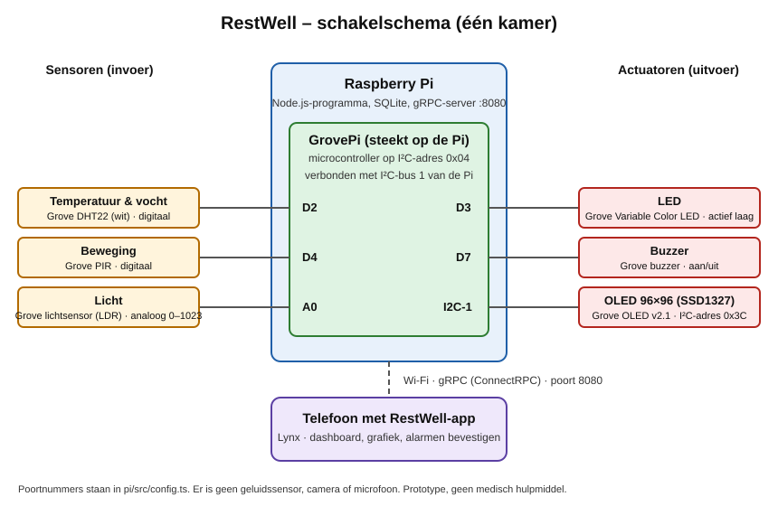

# RestWell

Future Technologies – Labo 01 Healthcare (Howest MCT)

> RestWell is een prototype voor een schoolproject en geen medisch hulpmiddel.

## Wat en waarom

Warmte, droge lucht en licht 's nachts beïnvloeden het comfort, de slaap en het herstel van een patiënt. Een verpleegkundige kan niet elke kamer permanent controleren. **RestWell bewaakt het binnenklimaat van een patiëntenkamer automatisch en alarmeert alleen als er iets afwijkt.** Zo krijgt de verpleging geen stroom meldingen, maar alleen een melding als het nodig is.

**Scenario.** Op een warme namiddag loopt de temperatuur in kamer 1 op tot 27 °C. De LED in de kamer gaat aan en de OLED toont "Te warm: 27 °C". In de app op de telefoon van de verpleegkundige wordt de kamer rood. Tikt niemand binnen 60 s op "Gezien", dan gaat de buzzer in de kamer af. Na "Gezien" stopt de buzzer en wordt de kamer oranje. Zodra de temperatuur weer normaal is, sluit het alarm vanzelf en wordt alles weer groen.

### Wat RestWell meet

| Meting               | Sensor                | Alarm als                               |
| -------------------- | --------------------- | --------------------------------------- |
| Temperatuur (°C)     | DHT22                 | onder 18 °C of boven 24 °C              |
| Luchtvochtigheid (%) | DHT22 (zelfde sensor) | onder 30 % of boven 60 %                |
| Licht (ruwe waarde)  | lichtsensor (LDR)     | boven 900, langer dan 60 s (demowaarde) |
| Beweging (ja/nee)    | PIR-bewegingssensor   | nooit: wordt alleen gelogd, als context |

Lawaai meten we bewust niet: er is geen geluidssensor, en een microfoon in een patiëntenkamer willen we vermijden (zie [privacy](docs/privacy.md)).

Ter plaatse tonen een **LED**, een **buzzer** en een **OLED-scherm** wat er mis is. In de **app** ziet de verpleging de huidige waarden, een grafiek, de actieve meldingen en de geschiedenis.

## Platformkeuze en motivatie

| Onderdeel         | Keuze                                                  | Waarom                                                                                                                                                                                                                     |
| ----------------- | ------------------------------------------------------ | -------------------------------------------------------------------------------------------------------------------------------------------------------------------------------------------------------------------------- |
| Hardware          | **Raspberry Pi** met een **GrovePi** en Grove-sensoren | Grove-modules klikken je aan zonder solderen of breadboard, wat snel en betrouwbaar is voor een project van één week. De GrovePi heeft ook analoge ingangen, die de Pi zelf niet heeft: de lichtsensor hangt daarom aan A0 |
| Lokale melding    | **LED**, **buzzer** en **OLED** (SSD1327, 96×96)       | De LED is meteen zichtbaar, de buzzer roept pas als niemand reageert (escalatie), en de OLED zegt **wat** er mis is                                                                                                        |
| Software op de Pi | **TypeScript op Node.js 24**, één programma            | Dezelfde taal als de app, dus dezelfde types uit het contract. Node voert TypeScript zelf uit, zonder build-stap                                                                                                           |
| Opslag            | **SQLite** (`better-sqlite3`)                          | Eén bestand op de Pi, geen aparte databaseserver. De data blijft lokaal, wat ook beter is voor de privacy                                                                                                                  |
| Communicatie      | **gRPC** met **ConnectRPC**, contract in `/proto`      | gRPC is verplicht. Connect spreekt het via gewone HTTP, zodat de Lynx-app het met `fetch` kan gebruiken. Server-streaming (`WatchRoom`) geeft live updates zonder te pollen                                                |
| Codegeneratie     | **Buf** met `protoc-gen-es`                            | Pi en app genereren hun types uit hetzelfde `.proto`-bestand, zodat ze niet uit elkaar lopen                                                                                                                               |
| App               | **Lynx** (ReactLynx, TypeScript)                       | Lynx is verplicht. Met ReactLynx werken we in een vertrouwde, React-achtige stijl                                                                                                                                          |

De volledige lijst met technische beslissingen staat in [AGENTS.md](AGENTS.md#genomen-beslissingen).

## Schakelschema



De poorten, I²C-adressen en de voorbereiding van de Pi staan in [`pi/src/hardware/README.md`](pi/src/hardware/README.md).

## Drempels en bronnen

| Meting           | Drempel                       | Bron                                                                                             |
| ---------------- | ----------------------------- | ------------------------------------------------------------------------------------------------ |
| Temperatuur      | 18–24 °C                      | WHO Housing and health guidelines (2018)                                                         |
| Luchtvochtigheid | 30–60 %                       | EPA: binnen onder 60 %, ideaal 30–50 %                                                           |
| Licht            | boven 900 (ruw), langer dan X | ICU-studies over licht 's nachts en slaap, plus onze eigen meting (gewoon kamerlicht geeft ±765) |

De volledige motivatie met links staat in [`pi/src/db/README.md`](pi/src/db/README.md#drempels-en-bronnen). De drempels zijn **aanpasbaar**: ze staan in de database en je wijzigt ze in de app op het drempelscherm. Een wijziging werkt meteen, zonder herstart.

## Gekozen uitbreidingen

1. **Tweerichtingscommunicatie: een alarm bevestigen vanuit de app.** De verpleegkundige tikt op "Gezien" en vult initialen of een rol in. De Pi zet het alarm op "bevestigd", de buzzer in de kamer stopt, en andere telefoons zien het meteen. LED en OLED blijven aan tot de waarde weer normaal is, zodat een probleem niet weggeklikt wordt.
2. **Een extra sensor: beweging (PIR).** Die geeft context in de app en op de OLED, bv. of er iemand in de kamer actief is. Beweging geeft bewust nooit een alarm, en we bewaren alleen ja of nee.

## Snel starten

Vereist Node.js 24 voor de Pi (`nvm use` in `pi/`). De details staan in de README van elk onderdeel.

**Op de Raspberry Pi** (met de sensoren), in `pi/`:

```bash
npm install
npm run generate
npm run dev
```

Voor de demo draait RestWell als service die vanzelf start: `bash deploy/install-service.sh`. Zie [`pi/README.md`](pi/README.md#op-de-pi-laten-draaien-service).

**Zonder Pi** (op een laptop, met nep-sensoren), in `pi/`:

```bash
npm install
npm run generate
npm run dev:fake
```

**De app**, in `app/`:

1. Kopieer `.env.example` naar `.env.local` en zet `PUBLIC_PI_URL` op het IP-adres van de Pi of de laptop, met poort 8080.
2. Start de app:

   ```bash
   npm install
   npm run dev
   ```

3. Open de app in **Lynx Explorer** op de iPhone (scan de QR-code) of in de iOS Simulator. Telefoon en Pi moeten op hetzelfde netwerk zitten. Zie [`app/README.md`](app/README.md).

Het script voor de demo staat in [`docs/demo-script.md`](docs/demo-script.md).

## Structuur

Dit project is een **monorepo**: alles zit in één repository. De mappen bovenaan zijn ingedeeld volgens **waar de code draait**: op de Pi, op de telefoon, of gedeeld. Binnen `/pi` heeft elke taak een eigen map.

```
proto/              ← het gRPC-contract (.proto), gedeeld door Pi en app
pi/                 ← alles wat op de Raspberry Pi draait (één Node.js-programma)
  src/hardware/     ← sensoren uitlezen, LED, buzzer en OLED aansturen
  src/db/           ← opslag in SQLite
  src/alarms/       ← beslissen wanneer er een alarm komt
  src/grpc/         ← gRPC-server die het contract uitvoert
  deploy/           ← RestWell als service op de Pi
app/                ← de Lynx-app op de telefoon
docs/               ← schakelschema, privacy, reflectie en demo
```

`/proto` is de enige bron van waarheid voor de communicatie tussen Pi en app: verandert het contract, dan zien beide kanten dat meteen.

## Wie werkt waar

| Taak       | Werkt in                                                   |
| ---------- | ---------------------------------------------------------- |
| Hardware   | [`pi/src/hardware`](pi/src/hardware)                       |
| Backend    | [`pi/src/db`](pi/src/db), [`pi/src/alarms`](pi/src/alarms) |
| Proto/gRPC | [`proto`](proto), [`pi/src/grpc`](pi/src/grpc)             |
| Lynx       | [`app`](app)                                               |

Hoe de onderdelen op de Pi samenwerken, staat in [`pi/README.md`](pi/README.md).

## Privacy en ethiek

Zie [`docs/privacy.md`](docs/privacy.md): welke data we verzamelen en waarom, waarom we een kamer-ID gebruiken in plaats van persoonsgegevens, wat we bewust niet meten (geen camera of microfoon) en hoe we het GDPR-bewust zouden aanpakken.

## Reflectie en AI-verantwoording

Zie [`docs/reflectie.md`](docs/reflectie.md): wat werkte, wat niet, de volgende stap, en welke AI-tools we gebruikten en wat we zelf controleerden.

## Werkafspraken

Zie [AGENTS.md](AGENTS.md) voor de structuur, de beslissingen en de regels voor codekwaliteit.
